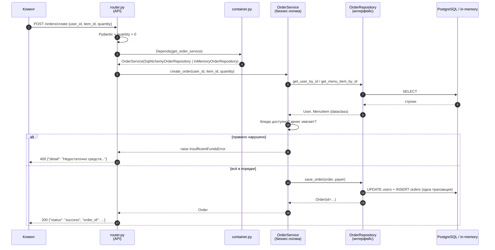
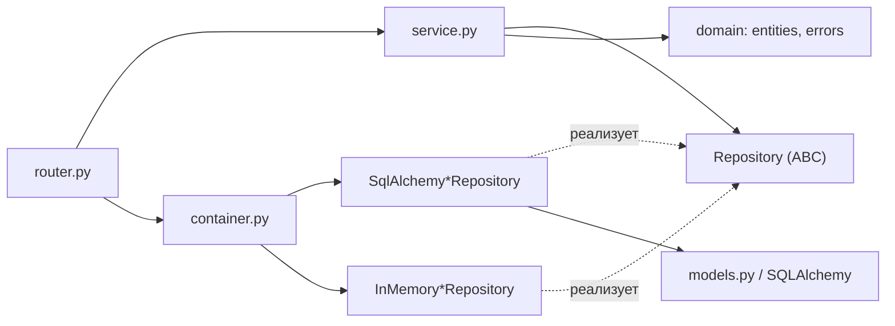

# Сириус.Еда — API столовой

Сквозной учебный проект по дисциплине «Разработка программных модулей и приложений для серверов».
Модульный монолит на FastAPI: `users`, `menu`, `orders`, `delivery`.

- **ЛР № 2.** Рефакторинг MVP-модулей в Clean Architecture (этот раздел, тег `pr2`).
- **ЛР № 3.** Аутентификация и авторизация (раздел ниже появится вместе с тегом `pr3`).

## Запуск

```bash
python -m venv .venv
source .venv/bin/activate            # Windows: .venv\Scripts\activate
pip install -r requirements-dev.txt

docker compose up -d db redis
uvicorn app.main:app --reload        # http://127.0.0.1:8000/docs
```

Без PostgreSQL, на in-memory хранилище:

```bash
STORAGE_BACKEND=memory uvicorn app.main:app --reload
```

Тесты (СУБД не нужна):

```bash
pytest
```

Проверка, что внешнее поведение API не изменилось после рефакторинга (нужен поднятый `db`):

```bash
python scripts/api_contract.py --check
# Проверено запросов: 36. Ответы идентичны MVP.
```

---

## ЛР № 2. Clean Architecture

### Что было

Каждый эндпоинт MVP-версии делал всё сам: валидировал запрос, ходил в БД через ORM,
проверял бизнес-правила и бросал `HTTPException`. Бизнес-правило нельзя было проверить
без веб-сервера и PostgreSQL, а замена СУБД задела бы каждый роутер.

### Что стало

Все четыре модуля разделены на три слоя по одному шаблону:

```
app/
├── domain/
│   ├── entities.py        # User, MenuItem, Order, Delivery — dataclass-ы без фреймворков
│   └── errors.py          # NotFoundError / ForbiddenError / BusinessRuleError
├── modules/<module>/
│   ├── router.py          # транспортный слой: HTTP, техническая валидация, ошибки -> статусы
│   ├── service.py         # бизнес-логика: правила и сценарии, без fastapi и sqlalchemy
│   ├── repository.py      # интерфейс репозитория (ABC) и две реализации
│   └── exceptions.py      # доменные исключения модуля
├── container.py           # composition root: сборка сервисов, выбор реализации хранилища
├── http_errors.py         # перевод доменных исключений в HTTPException
├── mappers.py             # ORM-модель -> доменная сущность
├── memory_storage.py      # in-memory «база» для InMemory-репозиториев
├── models.py              # ORM-модели SQLAlchemy
└── main.py
```

| Слой | Файл | Круг модели Мартина | Знает о |
|---|---|---|---|
| API | `router.py` | Frameworks & Drivers | FastAPI, Pydantic-схемы, сервис |
| Бизнес-логика | `service.py`, `domain/` | Entities + Use Cases | только сущности и интерфейс репозитория |
| Инфраструктура | `repository.py`, `models.py`, `mappers.py` | Interface Adapters | SQLAlchemy, таблицы |

### Путь запроса через слои



Направление зависимостей:



### Ключевые решения

- **Инверсия зависимостей.** Сервис получает репозиторий через конструктор и типизирован
  абстрактным классом (`OrderRepository(ABC)`), а не конкретной реализацией. Собирает слои
  `container.py`; роутер получает готовый сервис через `Depends(get_order_service)`.
- **Сервис работает с доменными сущностями, а не с ORM-объектами.** Репозиторий переводит
  строки таблиц в dataclass-ы (`mappers.py`), поэтому сервису всё равно, откуда пришли данные.
- **Доменные исключения вместо `HTTPException`.** Сервис бросает `UserNotFoundError`,
  `InsufficientFundsError` и т. п. Роутер переводит их в HTTP через `to_http()`: `NotFoundError` → 404,
  `ForbiddenError` → 403, `BusinessRuleError` → 400. Коды и тексты ошибок совпадают с MVP.
- **Атомарность.** В MVP списание баланса и создание заказа шли одним `commit`. Так и осталось:
  `save_order(order, payer)` сохраняет оба изменения одной транзакцией. Завершение доставки
  тоже меняет статусы доставки и заказа вместе (`save_completion`).
- **Техническая и бизнес-валидация.** Формат email (Pydantic), `quantity > 0`, сумма пополнения > 0,
  длина телефона — в роутере. Уникальность email и названия блюда, блокировка, лимит пополнения,
  баланс, статус заказа — в сервисе. «Цена > 0» и «название ≥ 2 символов» — инварианты блюда,
  они в `MenuService`, чтобы правило о цене было в одном месте для создания и изменения.

### Замена реализации репозитория (принцип подстановки Лисков)

У каждого интерфейса две реализации: `SqlAlchemy*Repository` (PostgreSQL) и `InMemory*Repository`.
Переключение — переменная `STORAGE_BACKEND`, `service.py` и `router.py` при этом не меняются.

Подтверждение:
- все unit-тесты сервисов параметризованы фикстурой `repos` и выполняются **на обеих реализациях**;
- `tests/test_api_memory.py` гоняет API целиком на in-memory хранилище;
- `scripts/api_contract.py --check` на PostgreSQL даёт ответы, идентичные MVP.

### Тесты

| Файл | Что проверяет |
|---|---|
| `tests/unit/test_*_service.py` | бизнес-правила всех четырёх сервисов, без запуска СУБД |
| `tests/test_architecture.py` | в `service.py` и `domain/` нет импортов `fastapi` / `sqlalchemy`, у каждого модуля три слоя |
| `tests/test_api_memory.py` | эндпоинты и перевод доменных ошибок в HTTP-статусы на in-memory хранилище |

Ответы на контрольные вопросы: [docs/pr2-answers.md](docs/pr2-answers.md).
