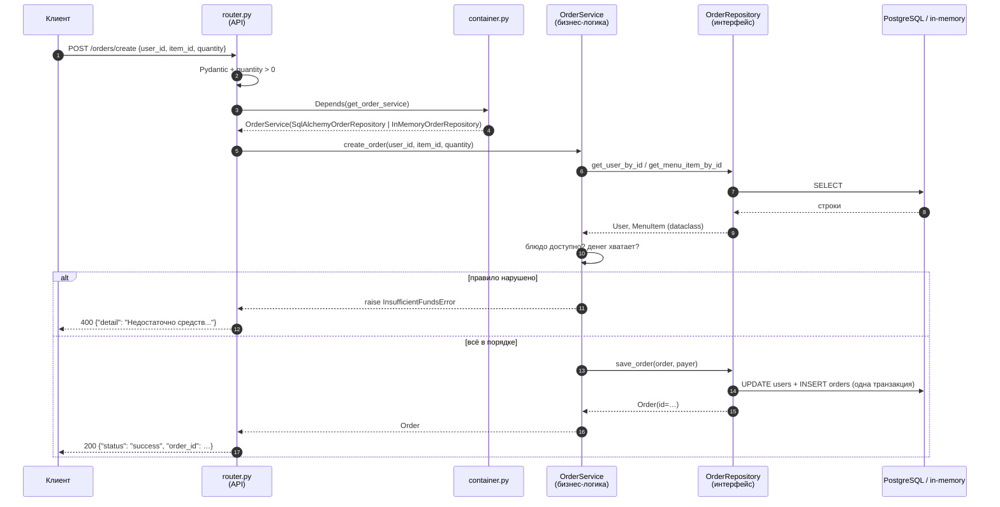
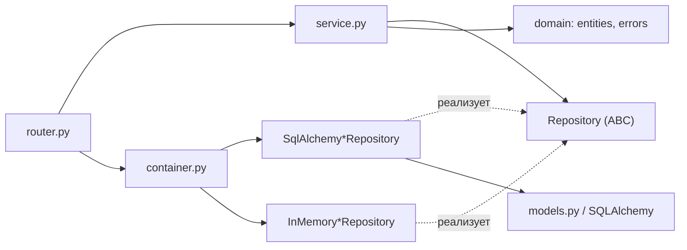
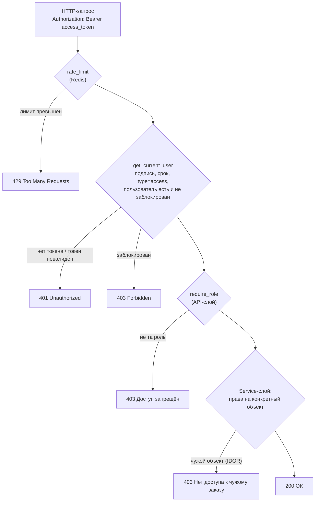
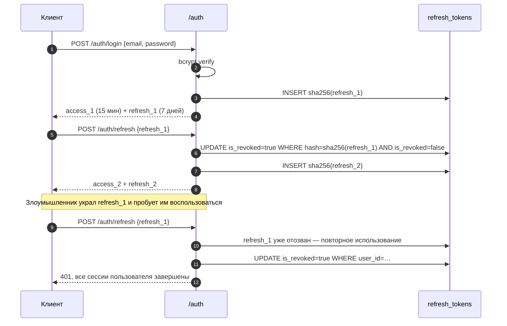

# Сириус.Еда — API столовой

Сквозной учебный проект по дисциплине «Разработка программных модулей и приложений для серверов».
Модульный монолит на FastAPI: `auth`, `users`, `menu`, `orders`, `delivery`.

- **ЛР № 2.** Рефакторинг MVP-модулей в Clean Architecture — [раздел ниже](#лр--2-clean-architecture), тег `pr2`.
- **ЛР № 3.** Аутентификация и авторизация: JWT, RBAC, защита от IDOR — [раздел ниже](#лр--3-безопасность-jwt-rbac-idor), тег `pr3`.

## Запуск

```bash
python -m venv .venv
source .venv/bin/activate            # Windows: .venv\Scripts\activate
pip install -r requirements-dev.txt

cp .env.example .env                 # задать SECRET_KEY; для Swagger — DEBUG=True
docker compose up -d db redis
alembic upgrade head                 # схема БД создаётся миграциями
python -m app.cli create-user admin@sirius.ru 'AdminPass123' --role admin
uvicorn app.main:app --reload        # http://127.0.0.1:8000/docs (при DEBUG=True)
```

В Swagger нажать **Authorize** и ввести email в поле `username` и пароль: токен подставится во все запросы.

Без PostgreSQL, на in-memory хранилище:

```bash
STORAGE_BACKEND=memory uvicorn app.main:app --reload
```

Тесты (СУБД и Redis не нужны, они же запускаются в CI — `.github/workflows/ci.yml`):

```bash
pytest
```

Сценарии проверки ЛР № 3 на запущенном сервере (401 / успех / 403 IDOR / 403 роль / 429):

```bash
python scripts/demo_security.py
```

---

## ЛР № 2. Clean Architecture

### Что было

Каждый эндпоинт MVP-версии делал всё сам: валидировал запрос, ходил в БД через ORM,
проверял бизнес-правила и бросал `HTTPException`. Бизнес-правило нельзя было проверить
без веб-сервера и PostgreSQL, а замена СУБД задела бы каждый роутер.

### Что стало

Все четыре модуля разделены на три слоя по одному шаблону:

```
app/
├── domain/
│   ├── entities.py        # User, MenuItem, Order, Delivery — dataclass-ы без фреймворков
│   └── errors.py          # NotFoundError / ForbiddenError / BusinessRuleError
├── modules/<module>/
│   ├── router.py          # транспортный слой: HTTP, техническая валидация, ошибки -> статусы
│   ├── service.py         # бизнес-логика: правила и сценарии, без fastapi и sqlalchemy
│   ├── repository.py      # интерфейс репозитория (ABC) и две реализации
│   └── exceptions.py      # доменные исключения модуля
├── container.py           # composition root: сборка сервисов, выбор реализации хранилища
├── http_errors.py         # перевод доменных исключений в HTTPException
├── mappers.py             # ORM-модель -> доменная сущность
├── memory_storage.py      # in-memory «база» для InMemory-репозиториев
├── models.py              # ORM-модели SQLAlchemy
└── main.py
```

| Слой | Файл | Круг модели Мартина | Знает о |
|---|---|---|---|
| API | `router.py` | Frameworks & Drivers | FastAPI, Pydantic-схемы, сервис |
| Бизнес-логика | `service.py`, `domain/` | Entities + Use Cases | только сущности и интерфейс репозитория |
| Инфраструктура | `repository.py`, `models.py`, `mappers.py` | Interface Adapters | SQLAlchemy, таблицы |

### Путь запроса через слои



Направление зависимостей:



### Ключевые решения

- **Инверсия зависимостей.** Сервис получает репозиторий через конструктор и типизирован
  абстрактным классом (`OrderRepository(ABC)`), а не конкретной реализацией. Собирает слои
  `container.py`; роутер получает готовый сервис через `Depends(get_order_service)`.
- **Сервис работает с доменными сущностями, а не с ORM-объектами.** Репозиторий переводит
  строки таблиц в dataclass-ы (`mappers.py`), поэтому сервису всё равно, откуда пришли данные.
- **Доменные исключения вместо `HTTPException`.** Сервис бросает `UserNotFoundError`,
  `InsufficientFundsError` и т. п. Роутер переводит их в HTTP через `to_http()`: `NotFoundError` → 404,
  `ForbiddenError` → 403, `BusinessRuleError` → 400. Коды и тексты ошибок совпадают с MVP.
- **Атомарность.** В MVP списание баланса и создание заказа шли одним `commit`. Так и осталось:
  `save_order(order, payer)` сохраняет оба изменения одной транзакцией. Завершение доставки
  тоже меняет статусы доставки и заказа вместе (`save_completion`).
- **Техническая и бизнес-валидация.** Формат email (Pydantic), `quantity > 0`, сумма пополнения > 0,
  длина телефона — в роутере. Уникальность email и названия блюда, блокировка, лимит пополнения,
  баланс, статус заказа — в сервисе. «Цена > 0» и «название ≥ 2 символов» — инварианты блюда,
  они в `MenuService`, чтобы правило о цене было в одном месте для создания и изменения.

### Замена реализации репозитория (принцип подстановки Лисков)

У каждого интерфейса две реализации: `SqlAlchemy*Repository` (PostgreSQL) и `InMemory*Repository`.
Переключение — переменная `STORAGE_BACKEND`, `service.py` и `router.py` при этом не меняются.

Подтверждение (состояние на теге `pr2`):
- все unit-тесты сервисов параметризованы фикстурой `repos` и выполняются **на обеих реализациях**;
- `tests/test_api_memory.py` гоняет API целиком на in-memory хранилище;
- `scripts/api_contract.py --check` прогоняет 36 запросов по всем модулям на PostgreSQL и сравнивает
  с эталоном MVP (`docs/contract_mvp.json`): «Ответы идентичны MVP».
  После ЛР № 3 эндпоинты требуют токен, поэтому скрипт остался только в теге `pr2`.

### Тесты

| Файл | Что проверяет |
|---|---|
| `tests/unit/test_*_service.py` | бизнес-правила всех сервисов, без запуска СУБД |
| `tests/test_architecture.py` | в `service.py` и `domain/` нет импортов `fastapi` / `sqlalchemy`, у каждого модуля три слоя |

Ответы на контрольные вопросы: [docs/pr2-answers.md](docs/pr2-answers.md).

---

## ЛР № 3. Безопасность: JWT, RBAC, IDOR

### Что было

После ЛР № 2 любой клиент мог создать заказ от имени другого пользователя (`user_id` в теле запроса),
отменить чужой заказ, менять меню и назначать курьеров. Паролей в системе не было вообще.

### Что сделано

| Требование | Где в коде |
|---|---|
| Миграции Alembic: `roles`, `users.password_hash`, `users.role_id`, `refresh_tokens` | `alembic/versions/` |
| Хеширование паролей bcrypt | `app/core/security.py`, `UserService.register` |
| JWT: access 15 мин, refresh 7 дней | `app/core/jwt.py`, модуль `app/modules/auth/` |
| `get_current_user`, `user_id` убран из `OrderCreate` | `app/core/dependencies.py`, `app/schemas.py` |
| RBAC: `require_role(...)` | `app/core/dependencies.py`, роутеры модулей |
| Защита от IDOR в Service-слое | `OrderService.cancel_order`, `UserService.top_up`, `DeliveryService.get_delivery / complete_delivery` |
| Rate limiting на Redis | `app/core/rate_limit.py` (вход, refresh, регистрация) |
| Secure by Default: секреты в `.env`, CORS, Swagger выключен при `DEBUG=False` | `app/core/config.py`, `app/main.py` |
| **10 баллов, вариант А:** Refresh Token rotation с обнаружением повторного использования | `AuthService.refresh` |
| **10 баллов, вариант Б:** защищены все модули (`users`, `menu`, `delivery`), а не только `orders` | роутеры и сервисы модулей |
| Тесты безопасности в CI | `tests/test_security.py`, `tests/unit/test_auth_service.py`, `.github/workflows/ci.yml` |

### Схема безопасности

Проверки идут слоями: каждый слой отвечает на свой вопрос.



| Вопрос | Кто отвечает | Ошибка |
|---|---|---|
| Не слишком ли часто? | `rate_limit` (Redis) | 429 |
| Кто ты? (аутентификация) | `get_current_user` (JWT) | 401 |
| Можно ли твоей роли этот эндпоинт? | `require_role` в роутере | 403 |
| Можно ли тебе этот объект? | сервис (`order.belongs_to(user)`) | 403 |

### Жизненный цикл токенов и ротация refresh-токена



- В БД хранится SHA-256 от refresh-токена, а не сам токен: утечка таблицы не даёт войти.
- Отзыв делается одним `UPDATE ... WHERE is_revoked = false`: два параллельных запроса с одним
  refresh-токеном не получат две новые пары.
- В каждом токене есть `type` (access / refresh) и уникальный `jti`. Refresh-токен не принимается
  как access и наоборот. При проверке подписи список алгоритмов задан явно (`HS256`).
- Уже выданные access-токены после сброса сессии живут до истечения (до 15 минут). Это осознанный
  компромисс stateless-JWT: короткий срок жизни access-токена и есть защита.

### Роли и права

| Эндпоинт | Кто может |
|---|---|
| `POST /auth/login`, `/auth/token`, `/auth/refresh`, `/auth/logout` | все (с rate limiting) |
| `POST /users/register` | все; роль всегда `student` |
| `GET /users/me` | любой аутентифицированный |
| `POST /users/{id}/topup` | владелец баланса или `admin` (проверка в сервисе) |
| `PATCH /users/{id}/role` | `admin` |
| `GET /menu/items` | все |
| `POST /menu/items`, `PATCH /menu/items/{id}` | `cook`, `admin` |
| `POST /orders/create` | `student`; `user_id` берётся из токена |
| `GET /orders/my` | любой аутентифицированный, только свои заказы |
| `POST /orders/{id}/cancel` | владелец заказа или `admin` (проверка в сервисе) |
| `GET /orders/kitchen/orders` | `cook`, `admin` |
| `POST /delivery/assign` | `admin`; назначить можно только пользователя с ролью `courier` |
| `GET /delivery/my` | `courier`, только свои доставки |
| `GET /delivery/{id}` | назначенный курьер, владелец заказа, `admin` (проверка в сервисе) |
| `PATCH /delivery/{id}/complete` | назначенный курьер или `admin` (проверка в сервисе) |

Первого администратора создаёт консольная команда `python -m app.cli create-user ... --role admin`:
она использует тот же `UserService`, что и API.

### Secure by Default

- `SECRET_KEY` и `DATABASE_URL` обязательны: без них приложение не стартует; ключ короче 32 символов отклоняется.
- `DEBUG=False` по умолчанию: `/docs` и `/openapi.json` не публикуются.
- CORS разрешён только доменам из `ALLOWED_ORIGINS` (по умолчанию — никому).
- `.env` в `.gitignore`, в репозитории только `.env.example`.
- Одинаковый ответ на «нет такого email» и «неверный пароль», плюс фиктивная bcrypt-проверка
  для несуществующего email, чтобы его не выдавало время ответа.
- Регистрация не позволяет выбрать роль, пароль — от 8 символов.

### Миграции

1. `525f51d7b14a_initial_schema_mvp` — схема MVP (autogenerate).
2. `508b885c512e_add_password_hash_roles_refresh_tokens` — autogenerate, затем доработка вручную:
   колонки сначала добавляются как nullable, заполняются роли, существующим пользователям
   назначается `student` и непригодный для входа хеш `!` (иначе `NOT NULL` упал бы на старых строках),
   у старых заказов заполняется `total_cost`; только после этого колонки становятся `NOT NULL`.

`total_cost` — сумма, списанная при оформлении заказа: при отмене возвращается именно она,
даже если цена блюда с тех пор изменилась.

### Тесты безопасности

`tests/test_security.py` (HTTP API, in-memory хранилище + fakeredis) и `tests/unit/test_auth_service.py`:

- без токена — 401; мусорный, просроченный, подписанный чужим ключом токен и refresh вместо access — 401;
- чужая роль — 403 (кухня, меню, создание заказа поваром, назначение ролей, доставки курьера);
- чужой объект — 403 (отмена чужого заказа, пополнение чужого баланса, чужая доставка);
- `user_id` в теле запроса игнорируется, заказ создаётся на владельца токена;
- rate limiting — 6-я попытка входа даёт 429, даже с верным паролем;
- ротация refresh-токена и сброс сессии при повторном использовании, logout;
- Swagger и `openapi.json` недоступны при `DEBUG=False`, CORS только для разрешённого домена.

CI (`.github/workflows/ci.yml`): `pytest` и отдельная проверка миграций на PostgreSQL
(`upgrade → downgrade → upgrade`, `alembic check`).

Ответы на контрольные вопросы: [docs/pr3-answers.md](docs/pr3-answers.md).
