# Сириус.Еда — API столовой

Сквозной учебный проект по дисциплине «Разработка программных модулей и приложений для серверов».
Модульный монолит на FastAPI: `auth`, `users`, `menu`, `orders`, `delivery`.

- **ЛР № 2.** Рефакторинг MVP-модулей в Clean Architecture — [раздел ниже](#лр--2-clean-architecture), тег `pr2`.
- **ЛР № 3.** Аутентификация и авторизация: JWT, RBAC, защита от IDOR — [раздел ниже](#лр--3-безопасность-jwt-rbac-idor), тег `pr3`.
- **ЛР № 4.** Кеширование: Cache-Aside на Redis — [раздел ниже](#лр--4-кеширование-cache-aside-на-redis), тег `pr4`.
- **ЛР № 5.** Фоновые задачи: Celery, ретраи, DLQ, Flower, Beat — [раздел ниже](#лр--5-фоновые-задачи-celery), тег `pr5`.
- **ЛР № 6.** Strangler Fig: delivery в gRPC-микросервис, стриминг — [раздел ниже](#лр--6-strangler-fig-delivery-в-grpc-микросервис), тег `pr6`.
- **ЛР № 7.** Event-driven: RabbitMQ, Saga, Transactional Outbox, DLQ — [раздел ниже](#лр--7-event-driven-rabbitmq-saga-transactional-outbox), тег `pr7`.
- **ЛР № 8.** SSR-витрина на Next.js: ISR, SEO, сравнение с CSR — [раздел ниже](#лр--8-ssr-витрина-на-nextjs), тег `pr8`.
- **ЛР № 9.** Observability: correlation ID, JSON-логи, Prometheus, Grafana, Jaeger, Sentry — [раздел ниже](#лр--9-observability-логи-метрики-трассировка), тег `pr9`.
- **ЛР № 10.** Testcontainers, Locust, CI, Pact, mutmut — [раздел ниже](#лр--10-интеграционные-тесты-нагрузка-ci-pact-mutmut), тег `pr10`.

## Запуск

```bash
python -m venv .venv
source .venv/bin/activate            # Windows: .venv\Scripts\activate
pip install -r requirements-dev.txt

cp .env.example .env                 # задать SECRET_KEY; для Swagger — DEBUG=True
docker compose up -d db redis
alembic upgrade head                 # схема БД создаётся миграциями
python -m app.cli create-user admin@sirius.ru 'AdminPass123' --role admin
uvicorn app.main:app --reload        # http://127.0.0.1:8000/docs (при DEBUG=True)
```

В Swagger нажать **Authorize** и ввести email в поле `username` и пароль: токен подставится во все запросы.

Без PostgreSQL, на in-memory хранилище:

```bash
STORAGE_BACKEND=memory uvicorn app.main:app --reload
```

Тесты (СУБД и Redis не нужны, они же запускаются в CI — `.github/workflows/ci.yml`):

```bash
pytest
```

Сценарии проверки ЛР № 3 на запущенном сервере (401 / успех / 403 IDOR / 403 роль / 429):

```bash
python scripts/demo_security.py
```

---

## ЛР № 2. Clean Architecture

### Что было

Каждый эндпоинт MVP-версии делал всё сам: валидировал запрос, ходил в БД через ORM,
проверял бизнес-правила и бросал `HTTPException`. Бизнес-правило нельзя было проверить
без веб-сервера и PostgreSQL, а замена СУБД задела бы каждый роутер.

### Что стало

Все четыре модуля разделены на три слоя по одному шаблону:

```
app/
├── domain/
│   ├── entities.py        # User, MenuItem, Order, Delivery — dataclass-ы без фреймворков
│   └── errors.py          # NotFoundError / ForbiddenError / BusinessRuleError
├── modules/<module>/
│   ├── router.py          # транспортный слой: HTTP, техническая валидация, ошибки -> статусы
│   ├── service.py         # бизнес-логика: правила и сценарии, без fastapi и sqlalchemy
│   ├── repository.py      # интерфейс репозитория (ABC) и две реализации
│   └── exceptions.py      # доменные исключения модуля
├── container.py           # composition root: сборка сервисов, выбор реализации хранилища
├── http_errors.py         # перевод доменных исключений в HTTPException
├── mappers.py             # ORM-модель -> доменная сущность
├── memory_storage.py      # in-memory «база» для InMemory-репозиториев
├── models.py              # ORM-модели SQLAlchemy
└── main.py
```

| Слой | Файл | Круг модели Мартина | Знает о |
|---|---|---|---|
| API | `router.py` | Frameworks & Drivers | FastAPI, Pydantic-схемы, сервис |
| Бизнес-логика | `service.py`, `domain/` | Entities + Use Cases | только сущности и интерфейс репозитория |
| Инфраструктура | `repository.py`, `models.py`, `mappers.py` | Interface Adapters | SQLAlchemy, таблицы |

### Путь запроса через слои

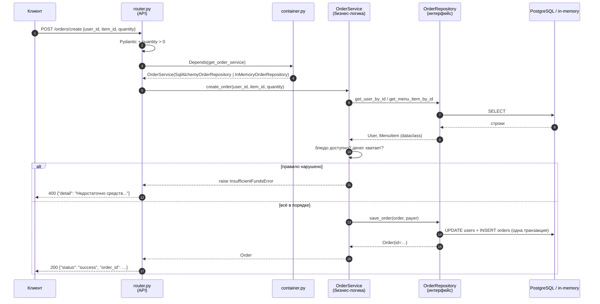

Направление зависимостей:

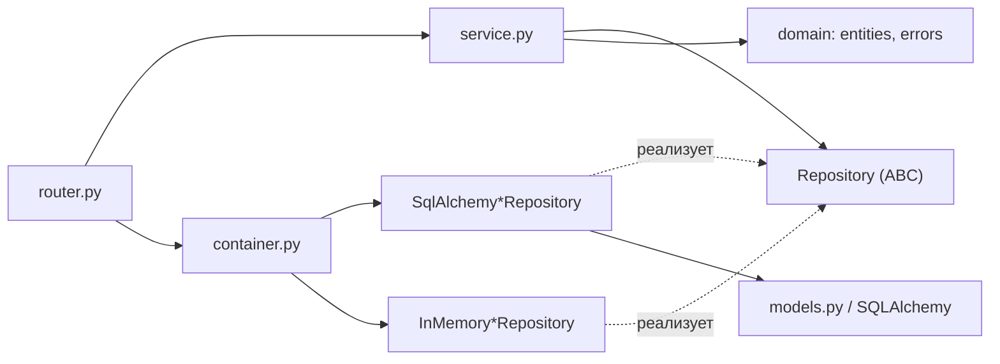

### Ключевые решения

- **Инверсия зависимостей.** Сервис получает репозиторий через конструктор и типизирован
  абстрактным классом (`OrderRepository(ABC)`), а не конкретной реализацией. Собирает слои
  `container.py`; роутер получает готовый сервис через `Depends(get_order_service)`.
- **Сервис работает с доменными сущностями, а не с ORM-объектами.** Репозиторий переводит
  строки таблиц в dataclass-ы (`mappers.py`), поэтому сервису всё равно, откуда пришли данные.
- **Доменные исключения вместо `HTTPException`.** Сервис бросает `UserNotFoundError`,
  `InsufficientFundsError` и т. п. Роутер переводит их в HTTP через `to_http()`: `NotFoundError` → 404,
  `ForbiddenError` → 403, `BusinessRuleError` → 400. Коды и тексты ошибок совпадают с MVP.
- **Атомарность.** В MVP списание баланса и создание заказа шли одним `commit`. Так и осталось:
  `save_order(order, payer)` сохраняет оба изменения одной транзакцией. Завершение доставки
  тоже меняет статусы доставки и заказа вместе (`save_completion`).
- **Техническая и бизнес-валидация.** Формат email (Pydantic), `quantity > 0`, сумма пополнения > 0,
  длина телефона — в роутере. Уникальность email и названия блюда, блокировка, лимит пополнения,
  баланс, статус заказа — в сервисе. «Цена > 0» и «название ≥ 2 символов» — инварианты блюда,
  они в `MenuService`, чтобы правило о цене было в одном месте для создания и изменения.

### Замена реализации репозитория (принцип подстановки Лисков)

У каждого интерфейса две реализации: `SqlAlchemy*Repository` (PostgreSQL) и `InMemory*Repository`.
Переключение — переменная `STORAGE_BACKEND`, `service.py` и `router.py` при этом не меняются.

Подтверждение (состояние на теге `pr2`):
- все unit-тесты сервисов параметризованы фикстурой `repos` и выполняются **на обеих реализациях**;
- `tests/test_api_memory.py` гоняет API целиком на in-memory хранилище;
- `scripts/api_contract.py --check` прогоняет 36 запросов по всем модулям на PostgreSQL и сравнивает
  с эталоном MVP (`docs/contract_mvp.json`): «Ответы идентичны MVP».
  После ЛР № 3 эндпоинты требуют токен, поэтому скрипт остался только в теге `pr2`.

### Тесты

| Файл | Что проверяет |
|---|---|
| `tests/unit/test_*_service.py` | бизнес-правила всех сервисов, без запуска СУБД |
| `tests/test_architecture.py` | в `service.py` и `domain/` нет импортов `fastapi` / `sqlalchemy`, у каждого модуля три слоя |

Ответы на контрольные вопросы: [docs/pr2-answers.md](docs/pr2-answers.md).

---

## ЛР № 3. Безопасность: JWT, RBAC, IDOR

### Что было

После ЛР № 2 любой клиент мог создать заказ от имени другого пользователя (`user_id` в теле запроса),
отменить чужой заказ, менять меню и назначать курьеров. Паролей в системе не было вообще.

### Что сделано

| Требование | Где в коде |
|---|---|
| Миграции Alembic: `roles`, `users.password_hash`, `users.role_id`, `refresh_tokens` | `alembic/versions/` |
| Хеширование паролей bcrypt | `app/core/security.py`, `UserService.register` |
| JWT: access 15 мин, refresh 7 дней | `app/core/jwt.py`, модуль `app/modules/auth/` |
| `get_current_user`, `user_id` убран из `OrderCreate` | `app/core/dependencies.py`, `app/schemas.py` |
| RBAC: `require_role(...)` | `app/core/dependencies.py`, роутеры модулей |
| Защита от IDOR в Service-слое | `OrderService.cancel_order`, `UserService.top_up`, `DeliveryService.get_delivery / complete_delivery` |
| Rate limiting на Redis | `app/core/rate_limit.py` (вход, refresh, регистрация) |
| Secure by Default: секреты в `.env`, CORS, Swagger выключен при `DEBUG=False` | `app/core/config.py`, `app/main.py` |
| **10 баллов, вариант А:** Refresh Token rotation с обнаружением повторного использования | `AuthService.refresh` |
| **10 баллов, вариант Б:** защищены все модули (`users`, `menu`, `delivery`), а не только `orders` | роутеры и сервисы модулей |
| Тесты безопасности в CI | `tests/test_security.py`, `tests/unit/test_auth_service.py`, `.github/workflows/ci.yml` |

### Схема безопасности

Проверки идут слоями: каждый слой отвечает на свой вопрос.

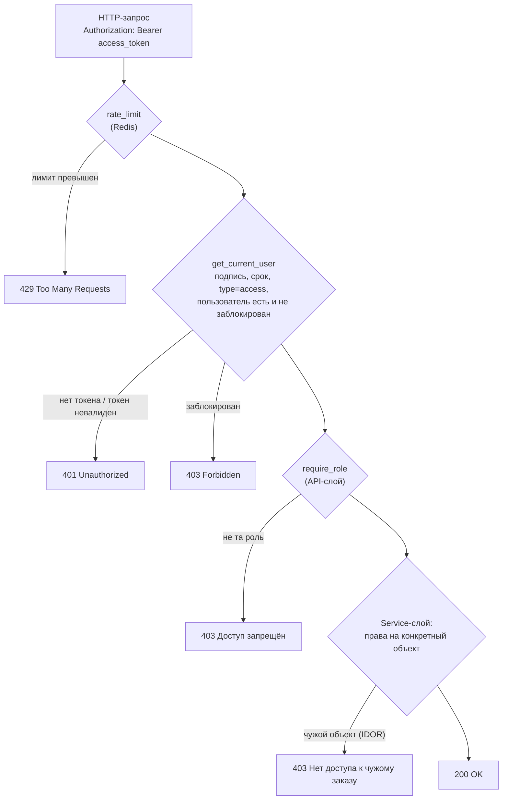

| Вопрос | Кто отвечает | Ошибка |
|---|---|---|
| Не слишком ли часто? | `rate_limit` (Redis) | 429 |
| Кто ты? (аутентификация) | `get_current_user` (JWT) | 401 |
| Можно ли твоей роли этот эндпоинт? | `require_role` в роутере | 403 |
| Можно ли тебе этот объект? | сервис (`order.belongs_to(user)`) | 403 |

### Жизненный цикл токенов и ротация refresh-токена

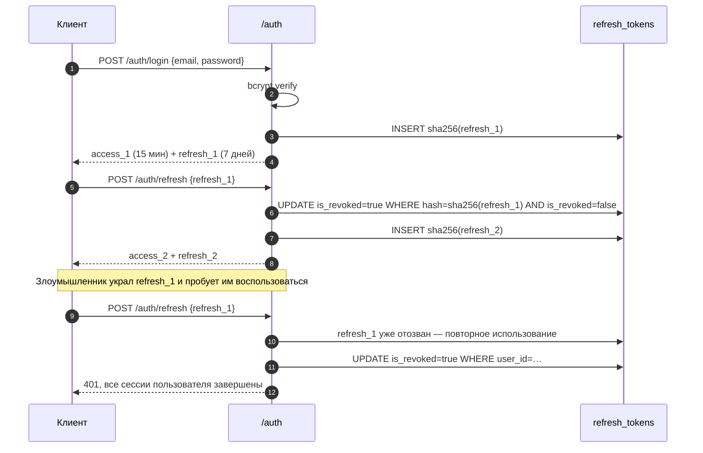

- В БД хранится SHA-256 от refresh-токена, а не сам токен: утечка таблицы не даёт войти.
- Отзыв делается одним `UPDATE ... WHERE is_revoked = false`: два параллельных запроса с одним
  refresh-токеном не получат две новые пары.
- В каждом токене есть `type` (access / refresh) и уникальный `jti`. Refresh-токен не принимается
  как access и наоборот. При проверке подписи список алгоритмов задан явно (`HS256`).
- Уже выданные access-токены после сброса сессии живут до истечения (до 15 минут). Это осознанный
  компромисс stateless-JWT: короткий срок жизни access-токена и есть защита.

### Роли и права

| Эндпоинт | Кто может |
|---|---|
| `POST /auth/login`, `/auth/token`, `/auth/refresh`, `/auth/logout` | все (с rate limiting) |
| `POST /users/register` | все; роль всегда `student` |
| `GET /users/me` | любой аутентифицированный |
| `POST /users/{id}/topup` | владелец баланса или `admin` (проверка в сервисе) |
| `PATCH /users/{id}/role` | `admin` |
| `GET /menu/items` | все |
| `POST /menu/items`, `PATCH /menu/items/{id}` | `cook`, `admin` |
| `POST /orders/create` | `student`; `user_id` берётся из токена |
| `GET /orders/my` | любой аутентифицированный, только свои заказы |
| `POST /orders/{id}/cancel` | владелец заказа или `admin` (проверка в сервисе) |
| `GET /orders/kitchen/orders` | `cook`, `admin` |
| `POST /delivery/assign` | `admin`; назначить можно только пользователя с ролью `courier` |
| `GET /delivery/my` | `courier`, только свои доставки |
| `GET /delivery/{id}` | назначенный курьер, владелец заказа, `admin` (проверка в сервисе) |
| `PATCH /delivery/{id}/complete` | назначенный курьер или `admin` (проверка в сервисе) |

Первого администратора создаёт консольная команда `python -m app.cli create-user ... --role admin`:
она использует тот же `UserService`, что и API.

### Secure by Default

- `SECRET_KEY` и `DATABASE_URL` обязательны: без них приложение не стартует; ключ короче 32 символов отклоняется.
- `DEBUG=False` по умолчанию: `/docs` и `/openapi.json` не публикуются.
- CORS разрешён только доменам из `ALLOWED_ORIGINS` (по умолчанию — никому).
- `.env` в `.gitignore`, в репозитории только `.env.example`.
- Одинаковый ответ на «нет такого email» и «неверный пароль», плюс фиктивная bcrypt-проверка
  для несуществующего email, чтобы его не выдавало время ответа.
- Регистрация не позволяет выбрать роль, пароль — от 8 символов.

### Миграции

1. `525f51d7b14a_initial_schema_mvp` — схема MVP (autogenerate).
2. `508b885c512e_add_password_hash_roles_refresh_tokens` — autogenerate, затем доработка вручную:
   колонки сначала добавляются как nullable, заполняются роли, существующим пользователям
   назначается `student` и непригодный для входа хеш `!` (иначе `NOT NULL` упал бы на старых строках),
   у старых заказов заполняется `total_cost`; только после этого колонки становятся `NOT NULL`.

`total_cost` — сумма, списанная при оформлении заказа: при отмене возвращается именно она,
даже если цена блюда с тех пор изменилась.

### Тесты безопасности

`tests/test_security.py` (HTTP API, in-memory хранилище + fakeredis) и `tests/unit/test_auth_service.py`:

- без токена — 401; мусорный, просроченный, подписанный чужим ключом токен и refresh вместо access — 401;
- чужая роль — 403 (кухня, меню, создание заказа поваром, назначение ролей, доставки курьера);
- чужой объект — 403 (отмена чужого заказа, пополнение чужого баланса, чужая доставка);
- `user_id` в теле запроса игнорируется, заказ создаётся на владельца токена;
- rate limiting — 6-я попытка входа даёт 429, даже с верным паролем;
- ротация refresh-токена и сброс сессии при повторном использовании, logout;
- Swagger и `openapi.json` недоступны при `DEBUG=False`, CORS только для разрешённого домена.

CI (`.github/workflows/ci.yml`): `pytest` и отдельная проверка миграций на PostgreSQL
(`upgrade → downgrade → upgrade`, `alembic check`).

Ответы на контрольные вопросы: [docs/pr3-answers.md](docs/pr3-answers.md).

---

## ЛР № 4. Кеширование: Cache-Aside на Redis

### Что сделано

- `app/core/redis.py` — клиент Redis (`decode_responses=True`) и `check_redis_connection()`.
- **Cache-Aside в репозитории** (`SqlAlchemyMenuRepository.list_all`): ключ `menu:all`, TTL 300 с.
  Hit — ответ из Redis без обращения к PostgreSQL; miss — запрос в БД и запись в кеш.
  Клиент Redis передаётся в репозиторий из `container.py`; `service.py` и `router.py` redis не импортируют
  (это проверяет архитектурный тест `test_service_does_not_import_frameworks`).
- **Инвалидация**: событийная — `MenuService.create_item` / `update_item` после сохранения вызывают
  `repository.invalidate_cache()`; по времени — TTL 5 минут.
- **Защита от cache stampede** (9 баллов): при miss в БД идёт только запрос, взявший блокировку Redis
  `lock:menu:all` (`redis.lock`, timeout 10 с); остальные ждут её и читают уже заполненный кеш.
- **Прогрев кеша** (10 баллов): при старте приложения (`lifespan` в `main.py`) `menu:all` заполняется
  из БД, первый запрос уже не идёт в базу.
- Если Redis недоступен, меню читается из PostgreSQL (медленнее, но сервис работает).

### Замеры

Locust, `GET /menu/items`, 500 пользователей, spawn rate 10, 90 секунд (`load/menu_peak.py`,
`python scripts/measure_menu_load.py before|after`). Нагрузка на БД — число транзакций PostgreSQL
за прогон (`pg_stat_database`) и CPU контейнера `db`: Load Average на Windows-стенде недоступен.

| Метрика | До (без кеша) | После (Redis) |
|---|---|---|
| Запросов всего | 701 | 24 109 |
| RPS | 8,5 | 270,5 |
| Ошибок | 80 (11,4 %): `QueuePool limit … reached` | 0 |
| Медиана | 32 мс | 1 100 мс |
| 95-й перцентиль | 71 000 мс | 1 600 мс |
| Максимум | 75 360 мс | 5 234 мс |
| Транзакций в PostgreSQL за прогон | 623 | 9 |
| CPU контейнера db, макс. | 8,7 % | 0,3 % |

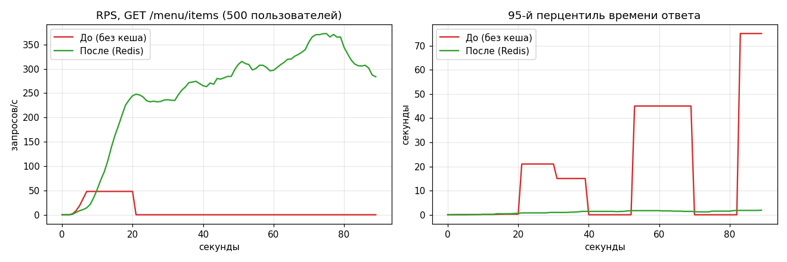

Без кеша каждый запрос занимает соединение из пула SQLAlchemy (5 + 10). На 20-й секунде пул
кончается: запросы ждут соединение по 30 секунд и падают с 500, RPS падает до нуля.
С кешем запросы не берут соединение с БД вообще (сессия не открывает соединение, пока нет SQL),
и сервис держит 250–370 RPS без ошибок, PostgreSQL получает только служебные запросы.
Медиана 1,1 с после внедрения — предел одного процесса uvicorn на стенде, где на том же ноутбуке
работает и Locust с 500 пользователями. Одиночный запрос без нагрузки: hit около 9 мс, miss около 18 мс
(`scripts/demo_cache.py`).

Отчёты Locust с графиками: [before.html](docs/pr4/before.html), [after.html](docs/pr4/after.html);
CSV и `*_db.json` — в `docs/pr4/`. График строится `scripts/plot_menu_load.py`.

### Проверка

```bash
docker compose up -d db redis
uvicorn app.main:app                          # при старте прогревается menu:all
python scripts/demo_cache.py                  # miss → hit → POST блюда → новое блюдо сразу в меню
docker compose exec redis redis-cli ttl menu:all
```

Тесты `tests/unit/test_menu_cache.py` (SQLite + fakeredis): hit не обращается к БД, miss заполняет кеш
с TTL, создание и изменение блюда сбрасывают кеш, прогрев, работа при упавшем Redis,
10 параллельных запросов при пустом кеше дают один запрос в БД.

Ответы на контрольные вопросы: [docs/pr4-answers.md](docs/pr4-answers.md).

---

## ЛР № 5. Фоновые задачи: Celery

### Что сделано

- `app/core/celery_app.py` — Celery с Redis в роли брокера и backend, JSON-сериализация,
  очереди `default` и `dlq`, расписание Celery Beat.
- `app/tasks/orders.py` — `generate_order_pdf` (2 с), `send_order_email` (1 с), `send_order_sms` (1 с).
- `OrderService.create_order` после сохранения заказа ставит задачи через `.delay()`
  (`_schedule_order_notifications`). Роутер и репозиторий о Celery не знают.
- **Ретраи** (`app/tasks/reliability.py`, `ReliableTask`): на любое исключение до 3 повторов
  с экспоненциальной задержкой 1 → 2 → 4 с. Email падает для каждого заказа с `order_id`, кратным 5.
- **DLQ**: когда ретраи исчерпаны, `ReliableTask.on_failure` кладёт задачу с теми же аргументами в очередь `dlq`.
  Воркер слушает только `default`, поэтому задачи в `dlq` лежат до ручного разбора.
- **Идемпотентность**: перед работой задача проверяет ключ `pdf_generated:{id}`, `email_sent:{id}` или
  `sms_sent:{id}` в Redis и ставит его после успеха (TTL 1 час). Повтор не создаёт дубль чека или письма.
- **Flower** (9 баллов): мониторинг задач в реальном времени на `:5555`.
- **Celery Beat** (10 баллов): раз в минуту `update_daily_order_stats` считает заказы за сегодня
  и пишет в Redis `stats:orders:daily`. Для подсчёта у заказа появилось поле `created_at` (миграция `fff4982f921f`).

### Замеры

`python scripts/measure_order_create.py before|after`: 20 последовательных `POST /orders/create`
после одного прогревочного запроса.

| Метрика | До (PDF, email, SMS синхронно) | После (Celery) |
|---|---|---|
| Среднее | 4 024 мс | 59 мс |
| Медиана | 4 022 мс | 63 мс |
| 95-й перцентиль | 4 034 мс | 76 мс |
| Максимум | 4 068 мс | 114 мс |

Ответ ускорился в 68 раз: клиент больше не ждёт 4 секунды заглушек, воркер выполняет их после ответа.

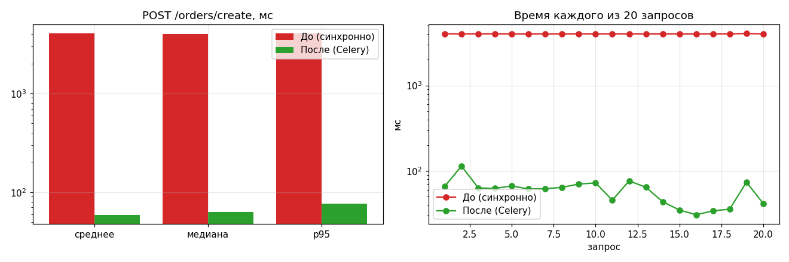

### Flower

Задачи в реальном времени: PDF, email и SMS каждого заказа, повтор PDF выполнен за 0 мс (уже был сгенерирован),
email для заказа 90 — FAILURE после ретраев:

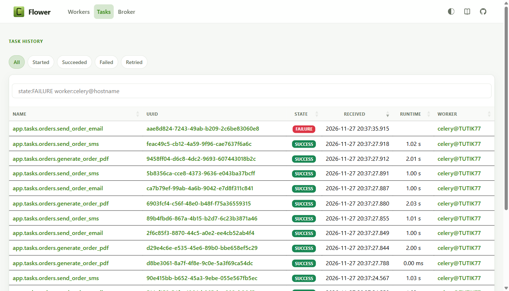

Карточка упавшей задачи (аргументы, время ретраев) и очереди брокера (6 задач в `dlq`):

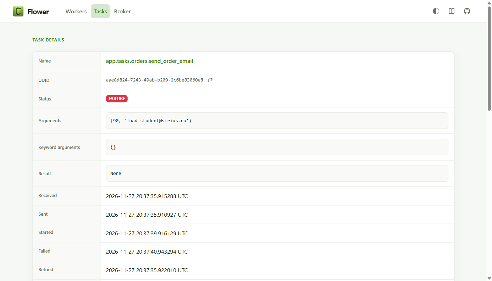
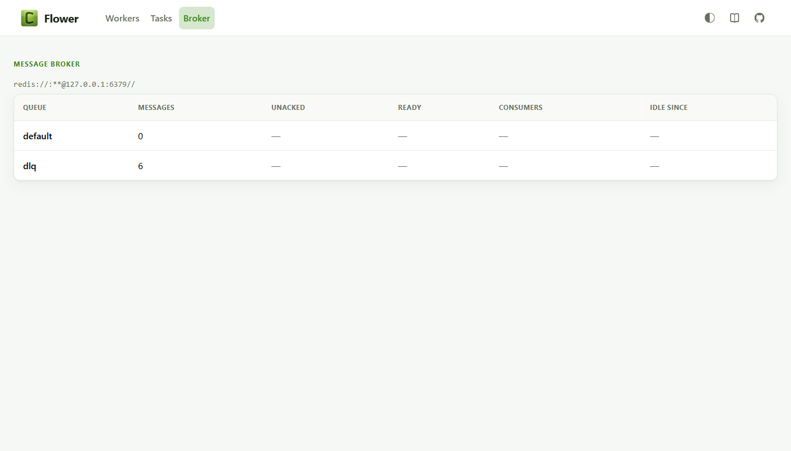

### Запуск

```bash
docker compose up -d db redis
alembic upgrade head
uvicorn app.main:app
celery -A app.core.celery_app worker -Q default --loglevel=info     # Windows: + --pool=threads
celery -A app.core.celery_app beat --loglevel=info
celery -A app.core.celery_app flower                                # http://localhost:5555
```

На Windows всё поднимает `scripts/dev_up.ps1` (логи в `logs/`).

### Проверка на сдаче

`python -m scripts.demo_tasks`:

1. Заказ создаётся за десятки миллисекунд, в логе воркера три задачи.
2. Повторная постановка `generate_order_pdf` для того же заказа — `PDF already generated`.
3. Заказ с `order_id`, кратным 5: `send_order_email` — `Retry in 1s`, `2s`, `4s`, затем запись о DLQ.
   Очередь: `redis-cli lrange dlq 0 -1`.
4. Статистика Beat: `redis-cli hgetall stats:orders:daily`.

Тесты `tests/unit/test_order_tasks.py`: сервис ставит три задачи (без телефона — без SMS),
идемпотентность PDF и email, падение email на заказе 5, политика ретраев, отправка в DLQ, подсчёт заказов за день.
В тестах `.delay` подменён фикстурой `scheduled_tasks`, брокер не нужен.

Ответы на контрольные вопросы: [docs/pr5-answers.md](docs/pr5-answers.md).

---

## ЛР № 6. Strangler Fig: delivery в gRPC-микросервис

### Что сделано

- `proto/delivery.proto` — контракт: `AssignCourier`, `GetDelivery`, `ListCourierDeliveries`, `CompleteDelivery`,
  `TrackDelivery` (server streaming), `ChatWithCourier` (bidirectional streaming).
  Код сгенерирован в `proto/delivery_pb2.py`, `proto/delivery_pb2_grpc.py`.
- `delivery_service/` — отдельный процесс на порту 50051. Сюда переехала бизнес-логика доставки
  (`service.py`, `repository.py`, `exceptions.py`), `server.py` — gRPC-сервер (`DeliveryServicer`).
- Монолит (`app/modules/delivery/`) больше не работает с таблицей `deliveries`:
  `router.py` зависит от интерфейса `DeliveryGateway` (`gateway.py`), реализация — `DeliveryGrpcClient`
  (`grpc_client.py`, инфраструктурный слой), подставляется в `container.py`.
- Права на доставку (RBAC и IDOR из ЛР № 3) сохранены: монолит проверяет JWT и роль,
  а в gRPC-запросе передаёт `Actor` (id и роль пользователя); владельца доставки проверяет микросервис.
- **Обработка ошибок** (8 баллов): таймаут каждого вызова 5 с. `UNAVAILABLE` и `DEADLINE_EXCEEDED` →
  `ServiceUnavailableError` → HTTP 503. Доменные ошибки идут по сети как статусы gRPC и превращаются
  обратно: `NOT_FOUND` → 404, `PERMISSION_DENIED` → 403, `FAILED_PRECONDITION` → 400.
- **Server Streaming** (9 баллов): `TrackDelivery` отдаёт статусы `in_progress → on_the_way → delivered`
  с паузой 2 с.
- **Bidirectional Streaming** (10 баллов): `ChatWithCourier` — на каждое сообщение клиента курьер сразу отвечает
  в том же потоке.

### Архитектура

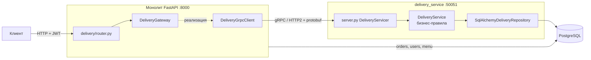

Strangler Fig: монолит продолжает обслуживать те же HTTP-эндпоинты `/delivery/*`, клиенты ничего не заметили,
но запросы «душатся» в новый сервис. Следующий шаг — отдельная БД для доставки.

### Запуск и проверка

```bash
python -m delivery_service.server       # терминал 1: Delivery gRPC server running on port 50051
uvicorn app.main:app                     # терминал 2
python -m scripts.demo_delivery          # assign → get → TrackDelivery → чат → complete
```

Перегенерация кода из контракта:

```bash
python -m grpc_tools.protoc -I. --python_out=. --pyi_out=. --grpc_python_out=. proto/delivery.proto
```

Вывод демонстрации и лог микросервиса:

```
1) HTTP POST /delivery/assign -> монолит -> gRPC AssignCourier: доставка 1
2) HTTP GET /delivery/1: {'id': 1, 'order_id': 91, 'courier_id': 7, 'status': 'in_progress'}
3) Server Streaming TrackDelivery: in_progress, on_the_way, delivered
4) Bidirectional Streaming ChatWithCourier:
   клиент: Где мой заказ?    курьер: Принял: «Где мой заказ?». Буду через 10 минут
5) HTTP PATCH /delivery/1/complete: 200

delivery_service AssignCourier order=91 courier=7
delivery_service GetDelivery delivery=1 actor=7
delivery_service TrackDelivery delivery=1
delivery_service Chat delivery=1 client: Где мой заказ?
delivery_service CompleteDelivery delivery=1 actor=7
```

Микросервис остановлен → `GET /delivery/my` отвечает `503 {"detail": "Сервис доставки недоступен"}`.

Тесты: `tests/test_delivery_grpc.py` (назначение и завершение по сети, ошибки 404/403 через gRPC,
недоступный сервис, стриминг статусов, чат, HTTP 503). HTTP-тесты безопасности доставки из ЛР № 3
теперь идут через настоящий gRPC-сервер, который фикстура `delivery_grpc_server` поднимает в тестовом процессе.

Ответы на контрольные вопросы: [docs/pr6-answers.md](docs/pr6-answers.md).

---

## ЛР № 7. Event-driven: RabbitMQ, Saga, Transactional Outbox

### Что сделано

- RabbitMQ в `docker-compose.yml` (`sirius_rabbitmq`, UI http://localhost:15672, sirius/sirius).
- `app/domain/events.py` — события `OrderPaid` (`order.paid`), `OrderCancelled` (`order.cancelled`),
  `DeliveryFailed` (`delivery.failed`), у каждого `event_id`.
- `POST /orders/{order_id}/pay` → `OrderService.pay_order`: статус `paid` и событие `OrderPaid`.
- **Transactional Outbox** (10 баллов): сервис не ходит в RabbitMQ. Репозиторий пишет новый статус заказа и
  событие в таблицу `outbox_events` одной транзакцией (`save_payment`). `app/workers/outbox_relay.py`
  раз в секунду публикует неопубликованные события в topic exchange `sirius_events` и ставит `published_at`.
  RabbitMQ лежит — оплата проходит, событие ждёт в outbox и уходит, когда брокер поднимется.
- Consumer'ы (`app/messaging/rabbitmq.py` → `consume`), каждый со своей очередью:
  - `app/workers/kitchen_consumer.py` — `kitchen_queue` ← `order.paid` (заказ в `kitchen_orders`),
    `order.cancelled` (заказ кухни отменяется);
  - `delivery_service/worker.py` — `delivery_queue` ← `order.paid`: назначает свободного курьера
    (`DeliveryService.assign_free_courier`), если курьера нет — пишет в outbox `delivery.failed`;
  - `app/workers/order_saga_consumer.py` — `orders_queue` ← `delivery.failed`: компенсация.
- **Идемпотентность**: перед обработкой consumer записывает пару (consumer, event_id) в `processed_events`
  в той же транзакции, что и свои изменения (`app/messaging/idempotency.py`). Повтор события пропускается.
- **DLQ**: у каждой очереди `x-dead-letter-exchange = dlx_exchange`. Если обработка упала (битый JSON, ошибка),
  сообщение отклоняется без возврата в очередь и попадает в `kitchen_dlq` / `delivery_dlq` / `orders_dlq`.
- **Saga, хореография** (9 баллов): нет курьера → `delivery.failed` → `OrderService.compensate_failed_delivery`
  возвращает деньги, отменяет заказ и публикует `order.cancelled` → кухня снимает заказ.
  Компенсация идемпотентна дважды: по `event_id` и по статусу (возврат только из `paid`).

### Архитектура

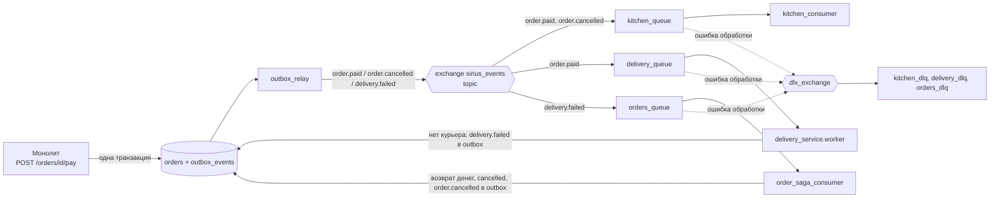

### Запуск и проверка

```bash
docker compose up -d db redis rabbitmq
alembic upgrade head
uvicorn app.main:app
python -m app.workers.outbox_relay
python -m app.workers.kitchen_consumer
python -m app.workers.order_saga_consumer
python -m delivery_service.worker
python -m delivery_service.server
python -m scripts.demo_events --outbox
```

Вывод демонстрации:

```
1) Заказ 94 оплачен: кухня [('pending',)], доставка — курьер [(7,)]
2) Saga: курьер занят -> delivery.failed -> заказ 95 cancelled, кухня отменила заказ,
   баланс после списания 227000.0 -> после возврата 227250.0
3) Повтор события 1f27e003-…: записей кухни для заказа 94 = 1
4) Битое сообщение: kitchen_dlq 1 -> 2, delivery_dlq 1 -> 2
5) RabbitMQ остановлен, заказ 96 оплачен, неопубликованных событий в outbox: 1
   RabbitMQ запущен: order.paid заказа 96 опубликован, кухня получила заказ
```

Тесты `tests/unit/test_events.py`: `pay_order` пишет `OrderPaid` в outbox, правила оплаты, компенсация один раз;
кухня принимает заказ один раз и отменяет его; доставка назначает свободного курьера или пишет `delivery.failed`;
Saga отменяет заказ и возвращает деньги ровно один раз; relay публикует и помечает события.

Ответы на контрольные вопросы: [docs/pr7-answers.md](docs/pr7-answers.md).

---

## ЛР № 8. SSR-витрина на Next.js

Вариант А (шаблон из Moodle), фронтенд в `frontend/`. Бэкенд: добавлен `GET /menu/items/{id}` (404, если блюда нет),
`scripts/seed_menu.py` наполняет меню.

### Что сделано

- `frontend/src/app/menu/page.tsx` — async Server Component: `getMenuItems()` выполняется на сервере Next.js,
  блюда приходят в HTML.
- `frontend/src/app/menu/[id]/page.tsx` — динамический маршрут: `await params`, `getMenuItem(id)`,
  `notFound()` для несуществующего блюда.
- `loading.tsx` — скелетон, пока сервер ждёт данные; `error.tsx` (`"use client"`) — понятная ошибка
  и кнопка «Попробовать снова» (`reset`), если API недоступен (8 баллов).
- **ISR и SEO** (9 баллов, вариант А): `export const revalidate = 60` на страницах и `next: { revalidate: 60 }`
  в `src/lib/api.ts`; `generateMetadata` у карточки блюда — `<title>`, `description`, `og:title`; метаданные меню.
- **CSR-версия** `/menu-csr` (10 баллов): `"use client"`, загрузка через `useEffect` + `fetch(..., { cache: "no-store" })`.

### Запуск

```bash
uvicorn app.main:app                 # бэкенд на 127.0.0.1:8000, ALLOWED_ORIGINS включает http://localhost:3000
python -m scripts.seed_menu
cd frontend
npm install
cp .env.example .env.local
npm run dev                          # или npm run build && npm start для проверки ISR
```

Проверки: `curl -s http://localhost:3000/menu | grep Сырники` — блюдо есть в HTML;
`/menu/1` + Ctrl+U — название, цена, `<title>`, `og:title`; остановить бэкенд и открыть `/menu/999999` — `error.tsx`.

### SSR и CSR

Production-сборка (`npm start`), кеш браузера выключен, по 3 замера на страницу.
FCP — first contentful paint, «блюда в DOM» — момент появления первой карточки блюда.

| Метрика | SSR: `/menu` | CSR: `/menu-csr` |
|---|---|---|
| Данные в Ctrl+U | есть | нет |
| FCP, мс (3 замера) | 136 / 120 / 152 | 100 / 104 / 104 |
| Блюда в DOM, мс (3 замера) | 35 / 32 / 35 | 128 / 197 / 196 |
| Первый контент | сразу с данными | каркас, данные после JS |
| Запрос к API из браузера | нет | есть (1) |

Вывод. SSR показывает меню сразу: блюда приходят в первом же HTML и появляются в DOM на ~35 мс, а CSR сначала
рисует пустой каркас (его FCP чуть раньше — страница легче), и блюда появляются только после загрузки JS
и запроса к API, в 4–6 раз позже. Поисковик и превью в мессенджерах видят у SSR готовое меню, у CSR — пустую
страницу. Для публичной витрины, где важны первая загрузка и SEO, выбираем SSR/ISR; CSR оставляем для
личного кабинета и интерактивных экранов за авторизацией, где SEO не нужен.

Ответы на контрольные вопросы: [docs/pr8-answers.md](docs/pr8-answers.md).

---

## ЛР № 9. Observability: логи, метрики, трассировка

### Что сделано

- **Correlation ID** (`app/core/correlation.py`): middleware берёт `X-Correlation-ID` из запроса или генерирует UUID,
  кладёт в `request.state`, в contextvar и в ответ. Дальше ID идёт по всей цепочке: при записи события в outbox
  он сохраняется в `outbox_events.headers`, relay кладёт его в заголовки сообщения RabbitMQ, consumer'ы
  (`app/messaging/context.py` → `continue_trace`) восстанавливают его перед обработкой. События, которые consumer
  сам пишет в outbox (`delivery.failed`, `order.cancelled`), наследуют тот же ID — вся Saga связана.
- **JSON-логи в stdout** (`app/core/logging.py`, structlog): в каждой записи `timestamp`, `level`, `service`,
  `correlation_id`, событие и поля (`order_created`, `order_paid`, `kitchen_order_accepted`, `delivery_failed`…).
- **Prometheus**: `/metrics` с RED-метриками (`prometheus-fastapi-instrumentator`), метрики очередей RabbitMQ
  (плагин `rabbitmq_prometheus`) и Redis (`redis_exporter`). Конфиг — `observability/prometheus/prometheus.yml`.
- **Grafana** (http://localhost:3001, admin/admin; порт 3000 занят витриной ЛР № 8): datasource и дашборд
  «Сириус.Еда» подключаются автоматически из `observability/grafana/` — RPS, latency p95, ошибки 5xx,
  длина очередей RabbitMQ, cache hit rate Redis.
- **Sentry** (9 баллов): `sentry_sdk.init` при заданном `SENTRY_DSN`, тег `correlation_id` ставит middleware,
  при `DEBUG=True` есть `GET /debug/error` для проверочной ошибки 500.
- **OpenTelemetry + Jaeger** (10 баллов): `app/core/tracing.py`, FastAPI инструментирован, контекст трейса
  (`traceparent`) едет через outbox и RabbitMQ вместе с correlation ID, relay и consumer'ы продолжают тот же trace.
- Весь стек запускается в Docker (`Dockerfile`, профиль `app` в `docker-compose.yml`): `sirius_app`, `sirius_kitchen`,
  `sirius_delivery`, `sirius_delivery_worker`, `sirius_orders_saga`, `sirius_outbox_relay`, `sirius_celery_worker`.

### Запуск

```bash
docker compose --profile app up -d --build
# Prometheus http://localhost:9090/targets, Grafana http://localhost:3001, Jaeger http://localhost:16686
```

### Расследование заказа demo-42

```bash
curl -i -X POST http://127.0.0.1:8000/orders/create -H "X-Correlation-ID: demo-42" -H "Authorization: Bearer $TOKEN" \
     -H "Content-Type: application/json" -d '{"item_id": 1, "quantity": 1}'          # в ответе X-Correlation-ID: demo-42
curl -X POST http://127.0.0.1:8000/orders/98/pay -H "X-Correlation-ID: demo-42" -H "Authorization: Bearer $TOKEN"
docker logs sirius_app | jq 'select(.correlation_id == "demo-42")'
docker logs sirius_kitchen | jq 'select(.correlation_id == "demo-42")'
```

На Windows без jq то же делает `python -m scripts.investigate_order demo-42`. Результат (заказ 98, свободного курьера
не было — видно и Saga):

```
sirius_app:          order_created {order_id: 98, user_id: 6, total_cost: 250.0}
                     POST /orders/create 200
                     order_paid {order_id: 98, event_id: a97db1a8-…}
                     POST /orders/98/pay 200
sirius_outbox_relay: event_published order.paid, delivery.failed, order.cancelled
sirius_kitchen:      kitchen_order_accepted {order_id: 98}
                     kitchen_order_cancelled {order_id: 98, reason: Нет свободного курьера}
sirius_delivery_worker: delivery_failed {order_id: 98, reason: Нет свободного курьера}
```

Все записи с `correlation_id: demo-42`. В Grafana за эти секунды — всплеск RPS на `/orders/create`, `/orders/{order_id}/pay`.
В Jaeger trace оплаты: 11 span'ов в 5 сервисах — `POST /orders/{order_id}/pay` → `publish order.paid` →
`kitchen_queue process` и `delivery_queue process` → `publish delivery.failed` → `orders_queue process` →
`publish order.cancelled` → `kitchen_queue process`. Самые долгие — обработка в consumer'ах (40–48 мс).

Тесты `tests/test_observability.py`: заголовок возвращается и генерируется, correlation ID попадает в outbox,
лог consumer'а содержит ID из заголовка сообщения, `/metrics` отдаёт RED-метрики.

Ответы на контрольные вопросы: [docs/pr9-answers.md](docs/pr9-answers.md).

---

## ЛР № 10. Интеграционные тесты, нагрузка, CI, Pact, mutmut

### Пирамида тестов в проекте

| Уровень | Где | Что проверяет |
|---|---|---|
| Unit и архитектура | `tests/unit`, `tests/test_architecture.py` и др. | сервисы на in-memory/SQLite, правила слоёв |
| Контракт | `tests/contract` | событие `order.paid` от заказов соответствует ожиданиям кухни (Pact) |
| Интеграция | `tests/integration` | HTTP → сервис → репозиторий → настоящая PostgreSQL в Docker |

### Интеграционные тесты (Testcontainers)

`tests/integration/conftest.py`: на сессию поднимается `postgres:15` через Testcontainers, схема накатывается
`alembic upgrade head` (как в проде), после каждого теста `TRUNCATE` всех таблиц — тесты изолированы.
`TestClient` работает с этой БД через подмену `get_session`; Redis подменён fakeredis, Celery — фикстурой.

Тесты `tests/integration/test_orders.py`: заказ сохраняется в БД и списывает баланс; при нехватке денег заказа нет;
оплата пишет заказ `paid` и событие в `outbox_events` одной транзакцией; блюдо читается из PostgreSQL, 404 для несуществующего.

```bash
pytest tests/integration -v        # 4 passed (~2 мин, нужен Docker)
```

### Нагрузочный тест (Locust)

`load/mixed.py`: 70 % — `GET /menu/items`, 20 % — `GET /menu/items/{id}`, 10 % — `POST /orders/create`,
пауза 1–3 с. Стенд — `docker compose --profile app up -d` (один процесс uvicorn).

```bash
locust -f load/mixed.py --host=http://127.0.0.1:8000     # 50 → 200 → 600 пользователей
```

| Пользователей | RPS | p95 | Ошибки | Комментарий |
|---|---|---|---|---|
| 50 | 25 | 42 мс | 0 | норма |
| 200 | 97 | 89 мс (`/orders/create` — 160 мс) | 0 | latency растёт, медленнее всех создание заказа |
| 600 | 52 | 30 000 мс | 1,1 % (500) | отказ: RPS падает, p95 > 1 с |

CSV Locust — в `docs/pr10/`.

**Узкое место — пул соединений PostgreSQL в монолите.** Как нашли: Prometheus (p95 по `handler`) показал, что растут
эндпоинты, которые ходят в БД (`/orders/create` — 389 мс на 200 пользователях), а при 600 ответы упёрлись ровно в 30 с;
в логах `sirius_app` — `sqlalchemy.exc.TimeoutError: QueuePool limit of size 5 overflow 10 reached, connection timed out,
timeout 30.00`. Пул SQLAlchemy по умолчанию — 15 соединений; запросы ждут свободное соединение 30 с, занимают потоки
threadpool'а FastAPI (40), и тогда встают даже `GET /menu/items`, которые отдаются из Redis. CPU контейнеров при этом
низкий — упираемся не в вычисления, а в ожидание ресурса.
Что делать: поднять `pool_size`/`max_overflow` под число потоков и лимит PostgreSQL, уменьшить `pool_timeout`, чтобы
быстро отдавать 503 вместо 30 с ожидания, запустить несколько воркеров uvicorn и PgBouncer, закешировать
`/menu/items/{id}` так же, как список.

### CI (GitHub Actions)

`.github/workflows/ci.yml` на каждый push и pull request:
`tests` — unit, архитектура, безопасность, контракт Pact с покрытием (`--cov`);
`integration` — Testcontainers (Docker есть на `ubuntu-latest`);
`migrations` — `upgrade → downgrade → upgrade` и `alembic check` на PostgreSQL.
Чтобы красный CI блокировал мерж: Settings → Branches → правило для `main` → Require status checks to pass
(выбрать `tests`, `integration`, `migrations`).

### Pact (9 баллов)

`tests/contract/test_order_paid_pact.py`, контракт `tests/contract/pacts/kitchen-orders.json`:
- потребитель (кухня) описывает ожидаемое сообщение «an order.paid event» — `event_id` (UUID) и `order_id` (целое) —
  и проверяет, что `kitchen_consumer.handle` его обрабатывает (создаётся заказ кухни);
- поставщик (заказы) проверяет, что `OrderPaid(...).payload()` соответствует контракту;
- поломка контракта: если переименовать `order_id` в `id`, верификация падает
  (`Actual map is missing the following keys: order_id`) — это закреплено тестом `test_renamed_field_breaks_contract`.

### mutmut (10 баллов)

Конфиг в `setup.cfg`: мутируется бизнес-логика `app/modules/orders/service.py` и `app/modules/menu/service.py`,
тесты — `tests/unit`. mutmut не работает на Windows, поэтому запуск в Linux-контейнере на образе проекта:

```bash
docker run --rm -v "$PWD:/src" -w /src sirius_food-app bash scripts/mutmut_run.sh
```

| | Убито | Выжило |
|---|---|---|
| До | 144 | 31 |
| После | 173 | 2 |

Что выживало и какие тесты добавлены:

- 18 мутаций в бизнес-логах (`order_created`, `order_paid`: имя события и поля заменялись на `None` или удалялись) —
  содержимое логов не проверялось. Добавлены `test_create_order_logs_business_event` и `test_pay_order_logs_event_id`
  (`structlog.testing.capture_logs`): эти логи нужны для расследований из ЛР № 9.
- Границы: `balance < total_cost` → `<=` (`test_balance_equal_to_cost_is_enough`), `len(name) < 2` → `<=` и `price <= 0` →
  `<= 1` (`test_name_of_exactly_two_chars_and_price_of_one_are_allowed`).
- Поля без проверок: `item_id=None` в заказе (проверка полей в `test_create_order_charges_balance`), `item.name = None`
  (`test_update_renames_item`), поля события `OrderCancelled` (`test_compensation_refunds_once`).
- `order.total_cost or 0.0` → `or 1.0` в оплате, отмене и компенсации: старые заказы без суммы.
  Добавлены `test_legacy_order_without_total_is_paid_and_refunded_as_zero` и `test_cancel_legacy_order_without_total_refunds_nothing`.

Две оставшиеся мутации эквивалентны: удаляется аргумент `status=OrderStatus.PROCESSING` или `is_available=True`, а это
и есть значения по умолчанию в dataclass-ах — поведение не меняется, убить такую мутацию никакой тест не может.

Ответы на контрольные вопросы: [docs/pr10-answers.md](docs/pr10-answers.md).
